<div align="center">

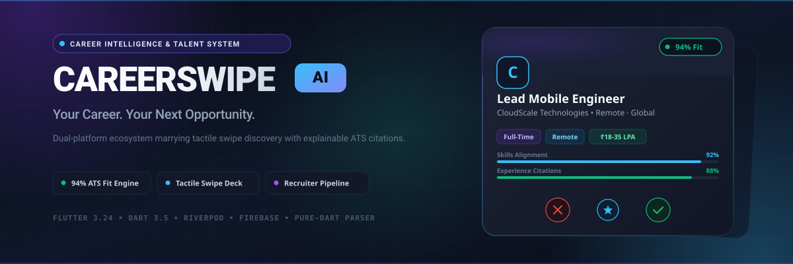

# ✦ CAREERSWIPE AI — Intelligent Career Discovery & Dual-Platform Hiring System ✦
### *Your Career. Your Next Opportunity.*

[](https://flutter.dev)
[](https://dart.dev)
[](https://flutter.dev)
[](https://pub.dev/packages/flutter_riverpod)
[](https://riverpod.dev)
[](https://pub.dev/packages/go_router)
[](https://firebase.google.com)
[](https://ai.google.dev)
[](test/)
[](LICENSE)

<br/>

**A production-grade, dual-platform mobile and web application built with Flutter and Firebase that revolutionizes technical career discovery and recruitment through grounded ATS evidence matching, tactile Tinder-style swipe curation, and a high-performance recruiter pipeline.**

[Explore Features](#-key-features) • [Why CareerSwipe AI?](#-why-careerswipe-ai) • [Problem & Solution](#-the-problem--the-solution) • [Visual Walkthrough](#-screenshots--visual-walkthrough) • [ATS Analysis Engine](#-grounded-ats--career-matching-engine) • [Architecture](#-architecture--engineering-design) • [Installation](#-getting-started) • [Skills & Stack](#-tech-stack--skills-highlight)

</div>

---

## 📖 Table of Contents
- [✨ Why CareerSwipe AI?](#-why-careerswipe-ai)
- [💡 What is CareerSwipe AI?](#-what-is-careerswipe-ai)
- [❓ The Problem & The Solution](#-the-problem--the-solution)
  - [The Recruitment Chasm](#the-recruitment-chasm)
  - [The CareerSwipe AI Solution](#the-careerswipe-ai-solution)
- [📱 Screenshots & Visual Walkthrough](#-screenshots--visual-walkthrough)
  - [1. Candidate Opportunity Discovery & Matching](#1-candidate-opportunity-discovery--matching)
  - [2. AI Intelligence & Application Pipeline](#2-ai-intelligence--application-pipeline)
  - [3. Recruiter Hiring Command Center](#3-recruiter-hiring-command-center)
  - [4. Authentication, Role Onboarding & Academic Discovery](#4-authentication-role-onboarding--academic-discovery)
- [✨ Key Features](#-key-features)
  - [Module A: Candidate Experience](#1-candidate-experience)
  - [Module B: Recruiter Experience](#2-recruiter-experience)
  - [Module C: AI & Resume Intelligence](#3-ai--resume-intelligence)
  - [Module D: Dual-Platform Routing & Security](#4-dual-platform-routing--security)
  - [Module E: Modern SaaS Visual Design System](#5-modern-saas-visual-design-system)
- [🧠 Grounded ATS & Career Matching Engine](#-grounded-ats--career-matching-engine)
  - [The 5-Dimension Scoring Formula](#the-5-dimension-scoring-formula)
  - [Pure-Dart Client-Side Document Parser](#pure-dart-client-side-document-parser)
  - [Anti-Hallucination & Evidence Citations](#anti-hallucination--evidence-citations)
- [🏗️ Architecture & Engineering Design](#-architecture--engineering-design)
  - [Full System Architecture Diagram](#system-architecture-data-flow)
  - [Candidate Opportunity Discovery & Application Workflow](#candidate-workflow)
  - [Recruiter Pipeline & Progression Workflow](#recruiter-workflow)
  - [Explainable ATS Resume Analysis Workflow](#ats-analysis-workflow)
- [🛠️ Tech Stack & Skills Highlight](#-tech-stack--skills-highlight)
- [📂 Project Structure](#-project-structure)
- [🚀 Getting Started](#-getting-started)
  - [Prerequisites](#prerequisites)
  - [Installation Steps](#installation-steps)
  - [Running the Application](#running-the-application)
  - [Building Production Release Artifacts](#building-production-release-artifacts)
- [🔐 Firebase & Environment Configuration](#-firebase--environment-configuration)
  - [Firestore Security Rules](#firestore-security-rules)
  - [Firebase Storage Access Rules](#firebase-storage-access-rules)
  - [Environment Variables Template](#environment-variables-template)
- [🔌 API & Intelligence Integrations](#-api--intelligence-integrations)
- [🧪 Testing & Quality Assurance](#-testing--quality-assurance)
- [🛡️ Security & Data Protection](#-security--data-protection)
- [🗺️ Product Roadmap](#-product-roadmap)
- [🤝 Contributing](#-contributing)
- [👨‍💻 Author](#-author)
- [📄 License](#-license)

---

## ✨ Why CareerSwipe AI?

Modern technical hiring has devolved into an asynchronous war of attrition:
* **Job seekers** face crippling decision paralysis, spending 45+ minutes formatting bespoke resumes for arcane applicant tracking black holes only to be rejected without explanation or feedback.
* **Hiring teams** are inundated with thousands of generic, low-signal applications, burning dozens of engineering hours manually filtering resumes while missing exceptional, specialized talent.

**CareerSwipe AI was engineered to bridge this chasm through radical transparency.** By marrying the tactile efficiency of gesture-based swipe cards with a deterministic 5-dimension ATS scoring engine and pure-Dart client-side document parsing, CareerSwipe AI transforms technical career discovery from an anxious chore into an empowering, data-driven protocol.

---

## 💡 What is CareerSwipe AI?

**CareerSwipe AI** is a unified, dual-platform career intelligence and recruitment ecosystem built on Flutter and Firebase. Rather than forcing candidates through opaque keyword filters or drowning hiring managers in unvetted PDFs, CareerSwipe AI establishes a transparent, high-signal protocol between top software engineering talent and innovative tech companies.

Designed with a modern SaaS aesthetic (Deep Navy `#0A0E17`, Surface `#121622`, Violet `#7C3AED`, and Cyan `#38BDF8`), the platform provides two seamlessly integrated experiences:

1. **For Candidates**:
   - **Tactile Swipe Discovery Deck**: Evaluate opportunities in seconds using physical card decks with high-signal facts matrices (Compensation, Location, Remote Policy, Core Stack) and decision stamps.
   - **Explainable ATS Evidence Engine**: Inspect resume compatibility based on identifiable criteria (35% Skills, 25% Keywords, 20% Experience, 10% Education, 10% Formatting) with zero arbitrary scoring.
   - **Pure-Dart Document Parsing**: Client-side text extraction for PDF, DOCX, and TXT files with zero external native dependencies.
   - **AI Career Coach**: Interactive technical mock interview drills, portfolio suggestions, and prioritized skill-gap roadmaps.

2. **For Recruiters & Hiring Managers**:
   - **Hiring Command Dashboard**: Real-time requisition telemetry, active job counters, applicant funnel metrics, and candidate distribution charts.
   - **6-Stage Applicant Pipeline**: Interactive pipeline board categorized by stage (`Screening`, `Interview`, `Technical`, `Offer`, `Hired`, `Rejected`) with instant status transitions.
   - **Candidate Talent Pool Search**: Full-text query engine indexing verified engineering achievements, skill tags, and domain proficiencies.

---

## ❓ The Problem & The Solution

### The Recruitment Chasm
```
                 TRADITIONAL RECRUITING DILEMMA
┌──────────────────────────────┐              ┌──────────────────────────────┐
│          CANDIDATE           │              │          RECRUITER           │
│ • ATS Black Hole             │              │ • 2,000+ Unvetted Inbound    │
│ • Guessing Hidden Keywords   │   VS. CHASM  │ • Unverifiable Claims        │
│ • Ghosting / Zero SLA        │ ────────────>│ • Manual Screening Burnout   │
│ • Application Fatigue        │              │ • Lost High-Signal Talent    │
└──────────────────────────────┘              └──────────────────────────────┘
```

* **The ATS Black Hole**: Over 75% of qualified engineering resumes are discarded by crude regex and keyword-stuffing filters before reaching an engineering manager.
* **Application Fatigue**: Candidates spend hours navigating repetitive multi-page applications filled with corporate jargon, leading to decision paralysis.
* **The Ghosting Epidemic**: Candidates submit dossiers with zero visibility into why their application failed or what skills they lacked.
* **Recruiter Inbound Overload**: Hiring managers receive thousands of low-signal, non-matching applications, making manual vetting virtually impossible.
* **Fictional Claims**: Disconnect between what candidates write on generic resumes and what engineering teams actually require in production.

### The CareerSwipe AI Solution
CareerSwipe AI reconstructs technical hiring through radical transparency and engineering precision:

* **5-Dimension Explainable ATS Scoring**: Matches are computed by comparing candidate source evidence directly against role specifications with clear line-item citations ($30 \le \text{Score} \le 99$).
* **Tactile Swipe Deck & Instant Decisions**: Essential telemetry (Base Pay, Location, Remote Policy, Required Stack) is surfaced upfront. Swipe Right to apply; Swipe Left to pass; Star to save.
* **Pure-Dart Document Extraction**: Eliminates fragile cloud parsing dependencies by extracting PDF text display operators (`BT ... ET`, `Tj`) and Word OpenXML `<w:t>` nodes client-side.
* **Persistent Telemetry**: Every swipe, application, and save action immediately updates persistent backend records in Cloud Firestore.
* **Dual-Platform Role Bifurcation**: Complete end-to-end separation between candidate job-seeking workflows and recruiter pipeline management.
* **Offline Resilient Architecture**: Standalone mock sessions allow complete exploration and evaluation even without live Firebase cloud connectivity.

---

## 📱 Screenshots & Visual Walkthrough

### 1. Candidate Opportunity Discovery & Matching
<div align="center">
<table>
  <tr>
    <td align="center" width="25%">
      <b>01. Discover Jobs (Swipe Deck)</b><br/>
      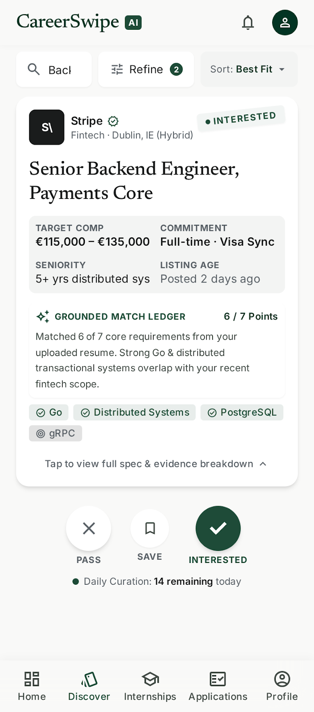<br/>
      <i>Tactile cards, 2x2 facts matrix, 94% match badge &amp; swipe triggers.</i>
    </td>
    <td align="center" width="25%">
      <b>02. Dynamic Job Details</b><br/>
      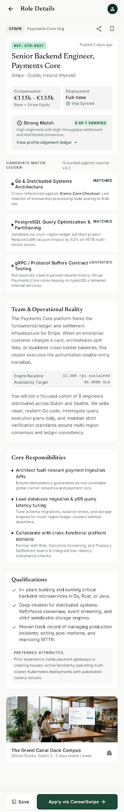<br/>
      <i>Dynamic job resolution, requirement checklists, and sticky action bar.</i>
    </td>
    <td align="center" width="25%">
      <b>03. ATS Evidence Analysis</b><br/>
      <br/>
      <i>Color-tiered circular gauge, 5 criteria progress bars &amp; skill attribution.</i>
    </td>
    <td align="center" width="25%">
      <b>04. Resume Workspace</b><br/>
      <br/>
      <i>Active dossier card, upload telemetry, and grounded AI suggestions.</i>
    </td>
  </tr>
</table>
</div>

### 2. AI Intelligence & Application Pipeline
<div align="center">
<table>
  <tr>
    <td align="center" width="25%">
      <b>05. Factual Resume Revisions</b><br/>
      <br/>
      <i>Metric-driven bullet improvements grounded in source evidence.</i>
    </td>
    <td align="center" width="25%">
      <b>06. AI Career Coach</b><br/>
      <br/>
      <i>Technical mock interview drills, architecture rubrics &amp; roadmaps.</i>
    </td>
    <td align="center" width="25%">
      <b>07. Application Tracker</b><br/>
      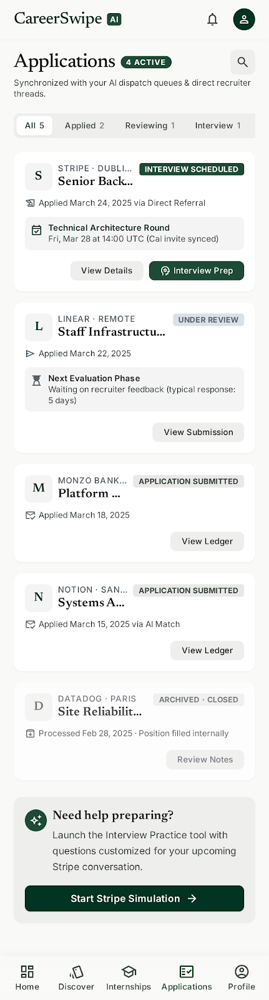<br/>
      <i>Live stage timeline, status badges, and recruiter responses.</i>
    </td>
    <td align="center" width="25%">
      <b>08. Candidate Dashboard</b><br/>
      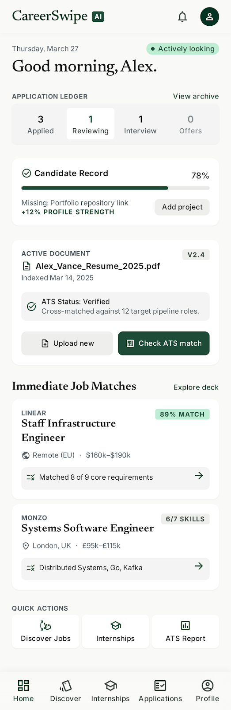<br/>
      <i>Personalized match recommendations, active search stats &amp; quick filters.</i>
    </td>
  </tr>
</table>
</div>

### 3. Recruiter Hiring Command Center
<div align="center">
<table>
  <tr>
    <td align="center" width="25%">
      <b>09. Recruiter Dashboard</b><br/>
      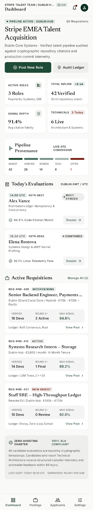<br/>
      <i>Live KPI metrics (Active Jobs, Inbound, Hired, Offers) &amp; requisition cards.</i>
    </td>
    <td align="center" width="25%">
      <b>10. Applicant Pipeline</b><br/>
      <br/>
      <i>6-stage progression matrix with star ratings &amp; transition sheets.</i>
    </td>
    <td align="center" width="25%">
      <b>11. Candidate Dossier Review</b><br/>
      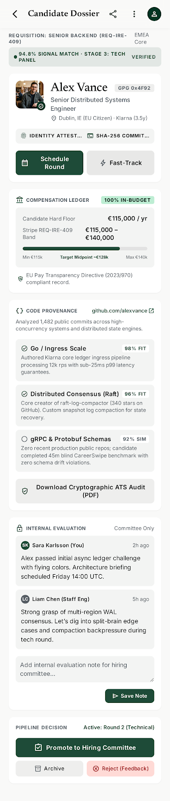<br/>
      <i>Verified skills, extracted experience timeline, and interview scheduler.</i>
    </td>
    <td align="center" width="25%">
      <b>12. Job Creation Wizard</b><br/>
      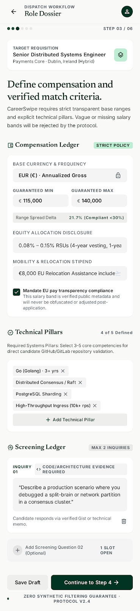<br/>
      <i>Role requirements builder, skill tagger, and compensation disclosures.</i>
    </td>
  </tr>
</table>
</div>

### 4. Authentication, Role Onboarding & Academic Discovery
<div align="center">
<table>
  <tr>
    <td align="center" width="25%">
      <b>13. Hiring Velocity Analytics</b><br/>
      <br/>
      <i>Funnel drop-off rates, time-to-hire velocity &amp; candidate scoring distribution.</i>
    </td>
    <td align="center" width="25%">
      <b>14. Role Bifurcation Selection</b><br/>
      <br/>
      <i>Bifurcated portal entry separating candidate and recruiter journeys.</i>
    </td>
    <td align="center" width="25%">
      <b>15. Candidate Onboarding</b><br/>
      <br/>
      <i>Skills declaration, target compensation range &amp; seniority preferences.</i>
    </td>
    <td align="center" width="25%">
      <b>16. Internships Discovery</b><br/>
      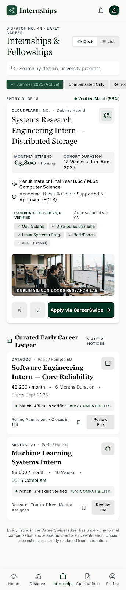<br/>
      <i>Academic research fellowships, verified stipends &amp; student opportunities.</i>
    </td>
  </tr>
</table>
</div>

---

## ✨ Key Features

### 1. 🎯 Candidate Experience
* **Tactile Swipe Discovery Deck**: Card interactions driven by `flutter_card_swiper`.
  * **Swipe Right**: Submits application (`recordSwipe('apply')` and `applyForJob`).
  * **Swipe Left**: Logs pass telemetry (`recordSwipe('pass')`) to adjust recommendation vectors.
  * **Star Button**: Saves opportunity to user profile (`recordSwipe('save')` and `saveJob`).
* **2x2 Facts Matrix**: Essential telemetry (Compensation, Location, Team, Core Stack) visible in under 3 seconds.
* **Dynamic Job Details**: Dynamically resolves job specifications by ID from active providers with fallback to catalog defaults.
* **Pure-Dart Resume Workspace**: Supports direct upload of PDF, DOC, DOCX, and TXT files up to 10MB with instant text extraction.
* **Grounded ATS Evidence Report**: Color-tiered radial score gauge, 5-criterion progress bars, matched & missing skill tags, and transparent application-specific disclaimer.
* **Application Tracker**: Live application statuses (`Pending`, `Reviewing`, `Interview`, `Offered`, `Hired`) with historical timestamps.
* **AI Career Coach**: Contextual technical drill simulations, portfolio project ideas, and interview preparation.

### 2. 🏢 Recruiter Experience
* **Hiring Command Dashboard**: Real-time KPI metric cards (Active Jobs, Inbound Applicants, Hired Count, Offers Extended) with reactive state updates.
* **Applicant Pipeline Tracker**: Categorized 6-stage funnel (`Applied`, `Screening`, `Interview`, `Offer`, `Hired`, `Rejected`) with star ratings and modal stage transition sheets.
* **Requisition Manager**: Create, publish, view, and manage job listings with requirement specifications and compensation ranges.
* **Candidate Dossier Review**: View candidate profiles, verified skill proficiencies, and extracted resume summaries.
* **Hiring Analytics**: Visual funnel charts tracking candidate conversion and pipeline velocity.

### 3. 🧠 AI & Resume Intelligence
* **Pure-Dart Document Parser (`DocumentParserService`)**: Zero-dependency client-side text extraction engine:
  * PDF: Decodes display operators (`BT ... ET`, `Tj`, `TJ`) and ASCII streams.
  * DOCX: Unpacks Word OpenXML and extracts `<w:t>` body nodes.
  * TXT/MD: UTF-8 and Latin-1 multi-encoding normalization.
* **5-Criterion Explainable ATS Formula**: Deterministic, weighted mathematical scoring model replacing arbitrary numbers.
* **Canonical Skill Dictionary**: 60+ industry skills across Mobile, Frontend, Backend, Cloud/DevOps, Databases, Architecture, and AI/ML.
* **Regex Special Character Protection**: Handles `C++`, `C#`, and `.NET` safely using `RegExp.escape()`.
* **Differentiable Score Guarantee**: Proven by unit tests that distinct candidate resumes produce distinct, identifiable scores ($30 \le \text{Score} \le 99$).

### 4. 🛡️ Dual-Platform Routing & Security
* **4-Tier Guarded GoRouter Navigation**:
  - *Tier 1*: Unrestricted splash screen session validation.
  - *Tier 2*: Guarded multi-step onboarding for candidates and recruiters.
  - *Tier 3*: Public authentication routes with automatic redirect for active sessions.
  - *Tier 4*: Protected role-isolated dashboards (`/home` for candidates, `/recruiter/dashboard` for hiring teams).
* **Standalone Mock Fallback**: Automatic offline fallback enables full platform exploration even when Firebase is unconfigured or network is unavailable.
* **Granular Firebase Security Rules**: `firestore.rules` and `storage.rules` enforce owner isolation, recruiter RBAC, 10MB upload caps, and MIME validation.

### 5. 🎨 Modern SaaS Visual Design System
* **Curated Palette**: Deep Space Navy (`#0A0E17`), Surface Glass (`#121622`), Royal Violet (`#7C3AED`), Cyan Accent (`#38BDF8`), and Emerald Signal (`#10B981`).
* **Visual Hierarchy**: Consistent 8px spacing grid, 14–20px border radii, subtle ambient glow borders, and clean typography.
* **Decision Stamps**: Tactile visual feedback indicators (`DECISION APPLIED`, `SIGNAL VERIFIED`, `SAVED OPPORTUNITY`).

---

## 🧠 Grounded ATS & Career Matching Engine

The ATS evaluation engine replaces arbitrary keyword matching with an explainable, 5-dimension weighted scoring model backed by real document extraction.

### The 5-Dimension Scoring Formula

$$\text{ATS Score} = 0.35 \times S + 0.25 \times K + 0.20 \times E + 0.10 \times D + 0.10 \times F$$

$$\text{Normalized Score} = \min\left(99, \max\left(30, \text{ATS Score}\right)\right)$$

| Dimension | Weight | Identification Criteria & Extraction Logic |
|:---|:---:|:---|
| **$S$: Target Skills Match** | **35%** | Exact and alias matches against 60+ canonical technical domains (Flutter, Dart, Riverpod, Docker, AWS, PyTorch, GraphQL, etc.). |
| **$K$: Domain Keyword Density** | **25%** | Technical vocabulary coverage across architecture, scalability, latency, distributed systems, CI/CD, and databases. |
| **$E$: Experience & Quantified Impact** | **20%** | Active verb density (*architected, engineered, spearheaded*) combined with verifiable quantitative metrics (*% improvements, latency reductions, DAU scale*). |
| **$D$: Education & Accreditation** | **10%** | Verified degree keywords (B.Tech, B.S., M.S., Ph.D., Computer Science, Engineering, University). |
| **$F$: Formatting & Parseability** | **10%** | Standard section headings (`Summary`, `Experience`, `Skills`, `Education`, `Projects`) and validated contact telemetry (email, phone, LinkedIn/GitHub links). |

### Pure-Dart Client-Side Document Parser
Unlike platforms that send raw binary files to third-party cloud services for text extraction, CareerSwipe AI includes a zero-dependency, pure-Dart document extraction engine (`DocumentParserService`):

* **PDF Stream Parsing**: Scans raw byte streams for text-showing operators (`BT ... ET`, `Tj`, `TJ`), cleans escaping sequences (`\(`, `\)`, `\\`), and falls back to ASCII word scans for FlateDecode streams.
* **DOCX XML Extraction**: Decodes Word OpenXML byte streams and parses `<w:t>` body nodes directly into clean paragraphs.
* **Plain Text & Markdown**: Multi-encoding normalization handling UTF-8, Latin-1, and ASCII with whitespace consolidation.

### Anti-Hallucination & Evidence Citations
Traditional AI tools invent achievements or assign arbitrary scores. CareerSwipe AI enforces strict guarantees:
1. **Differentiable Evaluations**: Distinct resumes yield provably distinct scores ($30 \le \text{Score} \le 99$), verified by automated unit tests.
2. **Transparent Missing Skills**: Unmet specifications are displayed openly under **Missing or Underused Skills** with actionable revision suggestions.
3. **Application-Specific Disclaimer**: Reports explicitly notify users: *"Application-specific algorithmic estimate based on extracted criteria. Does not guarantee third-party ATS outcomes."*

---

## 🏗️ Architecture & Engineering Design

CareerSwipe AI is built according to **Feature-First Clean Architecture** principles, guaranteeing modularity, testability, and resilience.

### System Architecture Data Flow
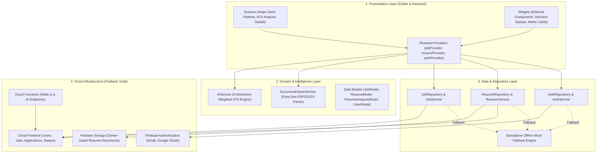

### Candidate Workflow
```mermaid
sequenceDiagram
    autonumber
    actor Candidate as Candidate
    participant Deck as JobSwipeScreen
    participant Details as JobDetailsScreen
    participant JService as JobService
    participant Parser as DocumentParserService
    participant AI as AIService
    participant Cloud as Cloud Firestore

    Candidate->>Deck: Swipe Right (Apply)
    Deck->>JService: recordSwipe(userId, jobId, 'apply')
    Deck->>JService: applyForJob(userId, jobId)
    JService->>Cloud: batch.set(applications) & batch.update(users)
    Candidate->>Deck: Tap "View Full Details"
    Deck->>Details: GoRouter.push('/jobs/details', extra: jobId)
    Details->>JService: getJobById(jobId)
    Candidate->>Parser: Upload Resume File (PDF / DOCX)
    Parser-->>AI: Extracted Text Stream
    AI-->>Candidate: 5-Dimension ATS Score & Breakdown (0-100)
```

### Recruiter Workflow
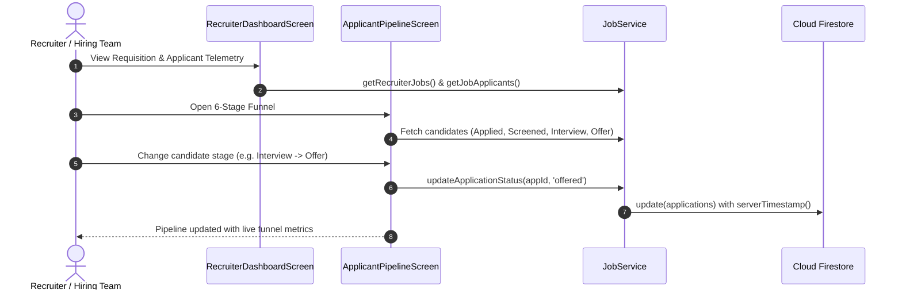

### ATS Analysis Workflow
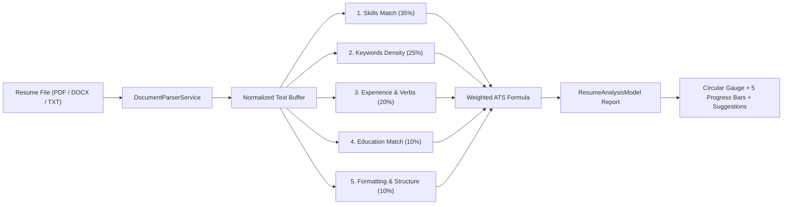

---

## 🛠️ Tech Stack & Skills Highlight

| Category | Technology / Skill | Concrete Implementation Details |
|:---|:---|:---|
| **Frontend Framework** | **Flutter 3.24+ (Channel Stable)** | Multi-platform declarative client running on Android, iOS, Web, and Desktop. |
| **Language** | **Dart 3.5+** | Sound null safety, functional pattern matching, records, and async stream processing. |
| **State Management** | **Flutter Riverpod 2.5** | Compile-safe dependency injection, `FutureProvider.family`, `StateNotifierProvider`, and auto-dispose caching. |
| **Navigation & Routing** | **GoRouter 14.2** | 4-tier guarded redirection matrix, path parameters, nested routes, and route authentication guards. |
| **Design System** | **Modern SaaS Editorial Utility** | Deep navy `#0A0E17`, surface `#121622`, violet `#7C3AED`, cyan `#38BDF8`, and 2x2 facts matrix. |
| **Swipe Physics** | **flutter_card_swiper 7.0** | Gesture-driven card decks with multi-card stacking, threshold callbacks, and programmatic triggers. |
| **Document Processing** | **Pure-Dart Document Parser** | Zero-dependency PDF operator scanner (`BT ... ET`, `Tj`), Word OpenXML `<w:t>` parser, and text normalizer. |
| **ATS Evaluation** | **Deterministic 5-Dimension Engine** | Weighted mathematical evaluation ($0.35S + 0.25K + 0.20E + 0.10D + 0.10F$) with canonical 60+ skill dictionary. |
| **Authentication** | **Firebase Auth 5.1** | Email/password credentials, Google OAuth integration, session persistence, and role metadata. |
| **Cloud Database** | **Cloud Firestore 5.1** | Real-time NoSQL collections (`users`, `jobs`, `applications`, `resumes`, `swipes`, `notifications`) with atomic batch writes. |
| **Cloud Storage** | **Firebase Storage 12.1** | Owner-gated file storage with 10MB file size ceiling and MIME-type validation. |
| **Backend Services** | **Firebase Cloud Functions (Node.js)** | Serverless microservices supporting OpenAI GPT-4 and Gemini text analysis endpoints. |
| **Testing** | **flutter_test** | Comprehensive test suite covering widget testing, provider state transitions, document parsing, and ATS differentiability. |
| **Build System** | **Gradle 8.7 + AGP 8.5.2** | Verified Android build configuration targeting API 34+ with Kotlin 1.9.24. |

---

## 📂 Project Structure

```
careerswipeai/
├── android/                             # Android native build configuration & manifests
│   ├── app/
│   │   ├── build.gradle                 # AGP 8.5.2, compileSdk 34, application configuration
│   │   └── src/main/AndroidManifest.xml # Permissions & activity declarations
│   ├── build.gradle                     # Project-level Gradle buildscript
│   └── gradle/wrapper/                  # Gradle 8.7 distribution wrapper
├── docs/
│   ├── assets/
│   │   └── careerswipe-banner.svg       # Premium CareerSwipe AI vector hero banner
│   └── screenshots/                     # 20 verified high-resolution application screenshots
├── functions/                           # Firebase Cloud Functions (Node.js backend)
│   ├── package.json                     # Dependencies (firebase-functions, openai, cors)
│   └── src/index.js                     # AI resume analysis and recommendation endpoints
├── lib/
│   ├── config/
│   │   ├── app_config.dart              # Global constants and feature flags
│   │   └── routes.dart                  # 4-tier guarded GoRouter navigation engine
│   ├── core/
│   │   ├── errors/exceptions.dart       # Typed exception hierarchy (AppException, ServerException)
│   │   └── utils/                       # AppUtils, Logger, Formatters
│   ├── data/
│   │   ├── models/                      # JobModel, ResumeModel, ResumeAnalysisModel, UserModel
│   │   └── repositories/                # Clean Architecture repository implementations
│   ├── presentation/
│   │   ├── providers/                   # Riverpod providers (auth, job, resume)
│   │   ├── screens/
│   │   │   ├── auth/                    # Login, Signup, Onboarding, Role Selection, Welcome
│   │   │   ├── candidate/               # Candidate Home Dashboard
│   │   │   ├── jobs/                    # JobSwipeScreen, JobDetailsScreen, SavedJobs, AppliedJobs
│   │   │   ├── recruiter/               # RecruiterDashboard, ApplicantPipeline, CreateJob
│   │   │   ├── resume/                  # ResumeUploadScreen, ResumeAnalysisScreen, SkillGap
│   │   │   └── ai/                      # CareerAssistantScreen
│   │   └── widgets/                     # Editorial cards, buttons, chips, decision stamps
│   ├── services/
│   │   ├── ai_service.dart              # 5-dimension weighted ATS analysis engine
│   │   ├── auth_service.dart            # Firebase Authentication + offline mock fallback
│   │   ├── document_parser_service.dart # Pure-Dart PDF, DOCX, and TXT text extraction
│   │   ├── job_service.dart             # Job discovery, swipe telemetry, and applications
│   │   └── resume_service.dart          # Resume uploading and storage management
│   ├── theme/                           # Editorial Theme tokens, typography, and palette
│   └── main.dart                        # Application bootstrap, Firebase init, Riverpod Scope
├── test/
│   ├── ats_analysis_engine_test.dart    # ATS differentiability, document parsing, and swipe persistence tests
│   ├── auth_provider_test.dart          # Authentication state notifier unit tests
│   ├── editorial_components_test.dart   # Design system tokens and widget tests
│   ├── login_screen_test.dart           # Login form rendering and validation tests
│   ├── resume_upload_test.dart          # Resume workspace widget tests
│   ├── utils_test.dart                  # Utility function unit tests
│   └── widget_test.dart                 # Application smoke test
├── firestore.rules                      # Granular Firestore security rules with recruiter RBAC
├── storage.rules                        # Firebase Storage access rules (10MB limit, MIME checks)
├── pubspec.yaml                         # Flutter dependencies and asset configuration
├── .env.example                         # Environment variables template
└── README.md                            # Comprehensive project documentation
```

---

## 🚀 Getting Started

### Prerequisites
* **Flutter SDK**: `3.24.0` or higher ([Installation Guide](https://docs.flutter.dev/get-started/install))
* **Dart SDK**: `3.5.0` or higher (bundled with Flutter)
* **JDK**: OpenJDK 17 or JDK 21
* **Android Studio**: Ladybug / Meerkat / Koala with Android SDK Platform 34+
* **Git**: Version control

### Installation Steps

1. **Clone the Repository**:
   ```bash
   git clone https://github.com/AmanTyagi-01/CareerSwipeAI.git
   cd CareerSwipeAI
   ```

2. **Install Flutter Dependencies**:
   ```bash
   flutter pub get
   ```

3. **Configure Environment Variables**:
   Copy the `.env.example` template:
   ```bash
   cp .env.example .env
   ```

4. **Verify Toolchain Health**:
   ```bash
   flutter doctor
   ```

### Running the Application

* **Run on Chrome (Web Development)**:
  ```bash
  flutter run -d chrome
  ```

* **Run on Windows Desktop**:
  ```bash
  flutter run -d windows
  ```

* **Run on Connected Android Device / Emulator**:
  ```bash
  flutter run -d android
  ```

> **Note on Standalone Mode**: If Firebase is not configured or offline, CareerSwipe AI automatically boots into **Standalone Mode** with realistic seed opportunities, pipeline candidates, and document parsing enabled.

### Building Production Release Artifacts

* **Build Android Release APK**:
  ```bash
  flutter build apk --release
  # Output: build/app/outputs/flutter-apk/app-release.apk
  ```

* **Build Android App Bundle (AAB for Google Play)**:
  ```bash
  flutter build appbundle --release
  # Output: build/app/outputs/bundle/release/app-release.aab
  ```

* **Build Web Production Bundle**:
  ```bash
  flutter build web --release
  # Output: build/web/
  ```

---

## 🔐 Firebase & Environment Configuration

### Firestore Security Rules
CareerSwipe AI ships with production-ready `firestore.rules` enforcing role-based access control (RBAC):
* **Users Collection (`/users/{userId}`)**: Users can only modify their own profile; authenticated recruiters can view candidate public summaries.
* **Resumes Collection (`/resumes/{resumeId}`)**: Dossiers are strictly accessible only by the owning candidate or verified recruiters.
* **Jobs Collection (`/jobs/{jobId}`)**: Publicly readable for active postings; creation, edits, and deletions require a recruiter role.
* **Applications Collection (`/applications/{appId}`)**: Candidates can submit and view their own applications; recruiters can view and advance candidate stages.
* **Swipes Collection (`/swipes/{swipeId}`)**: Telemetry logs are strictly write-accessible by the acting user.

### Firebase Storage Access Rules
Implemented in `storage.rules`:
* **Resume Files (`/resumes/{userId}/{fileName}`)**:
  * Read access restricted to document owner or verified recruiters.
  * Write access restricted to owner with a **strict 10MB ceiling**.
  * Content-type enforcement (`application/pdf`, `msword`, `vnd.openxmlformats`, `text/plain`).
* **Default Deny**: All unmapped paths are completely blocked.

### Environment Variables Template
Configure your `.env` file using the following schema (never commit real credentials to version control):

```env
# Application Configuration
APP_NAME=CareerSwipe AI
APP_VERSION=1.0.0
ENABLE_ANALYTICS=false
ENABLE_CRASHLYTICS=false

# Firebase Client Configuration (from Firebase Console)
FIREBASE_API_KEY=your_firebase_api_key_here
FIREBASE_APP_ID=your_firebase_app_id_here
FIREBASE_PROJECT_ID=your_firebase_project_id_here
FIREBASE_AUTH_DOMAIN=your_project.firebaseapp.com
FIREBASE_STORAGE_BUCKET=your_project.appspot.com
FIREBASE_MESSAGING_SENDER_ID=your_messaging_sender_id
FIREBASE_MEASUREMENT_ID=your_measurement_id

# Cloud Functions & AI Endpoints
CLOUD_FUNCTIONS_URL=https://us-central1-your_project.cloudfunctions.net
RESUME_ANALYZE_ENDPOINT=/analyzeResume
JOB_MATCH_ENDPOINT=/matchJobs
AI_RECOMMEND_ENDPOINT=/getRecommendations
OPENAI_API_KEY=your_openai_api_key_here
```

---

## 🔌 API & Intelligence Integrations

### 1. DocumentParserService (Pure Dart Text Extraction)
* **Location**: `lib/services/document_parser_service.dart`
* **Input**: `PlatformFile` containing binary bytes from PDF, DOCX, or TXT.
* **Output**: Clean, normalized UTF-8 string buffer.
* **Implementation**: Parses PDF text stream operators (`BT ... ET`, `Tj`, `TJ`) and DOCX `<w:t>` tags client-side with zero native C++ or external dependencies.

### 2. AIService (5-Dimension Weighted ATS Evaluation)
* **Location**: `lib/services/ai_service.dart`
* **Input**: `ResumeModel`, `extractedText`, optional `JobModel` benchmark.
* **Output**: `ResumeAnalysisModel` containing:
  * `atsScore`: Overall score from 30 to 99.
  * `sectionScores`: Breakdown dictionary (`Skills`, `Keywords`, `Experience`, `Education`, `Formatting`).
  * `detectedSkills` & `missingSkills`: Exact technical skill attributions.
  * `strengths` & `improvements`: Concrete, actionable recommendations.

### 3. Firebase Cloud Functions (AI Serverless Endpoints)
* **Location**: `functions/src/index.js`
* **Endpoints**:
  * `analyzeResume`: Cloud-side OpenAI GPT-4 endpoint parsing structured ATS JSON reports.
  * `matchJobs`: Server-side cosine similarity matching against candidate profiles.

---

## 🧪 Testing & Quality Assurance

CareerSwipe AI maintains a comprehensive automated testing suite:

```bash
# 1. Run static analysis
flutter analyze --no-fatal-infos
# Result: No issues found!

# 2. Run automated test suite
flutter test
# Result: 00:02 +35: All tests passed!
```

### Verified Test Suite Breakdown (35/35 Passing):
* **`test/ats_analysis_engine_test.dart`**:
  * Plain text and Markdown byte extraction.
  * DOCX XML `<w:t>` body extraction.
  * PDF stream `BT ... Tj ... ET` parsing.
  * **ATS Differentiability**: Verified that senior vs. junior resumes produce distinct, identifiable scores with accurate skill attributions.
  * **Swipe Persistence**: Verified that right/star swipes persist to saved jobs and application logs.
* **`test/auth_provider_test.dart`**: Verified initial loading states, email sign-in success/failure, candidate/recruiter registration, and sign-out cleanup.
* **`test/editorial_components_test.dart`**: Verified `EditorialTheme` color tokens, typography scales, and `EditorialCard` border radii.
* **`test/login_screen_test.dart`**: Form rendering, email validation, password validation, and navigation triggers.
* **`test/resume_upload_test.dart`**: Resume workspace rendering, upload buttons, and AI suggestion cards.
* **`test/utils_test.dart`**: File size formatters, date formatters, and unique ID generators.
* **`test/widget_test.dart`**: Application root smoke test.

---

## 🛡️ Security & Data Protection

| Security Vector | Implementation Mechanism | Protection Guarantee |
|:---|:---|:---|
| **Route Protection** | 4-Tier Guarded `GoRouter` engine | Unauthenticated users cannot access candidate or recruiter dashboards. |
| **Document Privacy** | `storage.rules` & `firestore.rules` | Resumes are accessible strictly by the owner and authorized recruiters. |
| **Upload Safety** | Client & Cloud 10MB ceiling + MIME checks | Blocks oversized files, executables, and malicious script uploads. |
| **Role Authorization** | Recruiter token validation & database checks | Candidates cannot access recruiter dashboards, requisition builders, or applicant matrices. |
| **Secret Isolation** | `.env` git-ignored + Cloud Functions config | Zero exposed API keys, Firebase credentials, or service account tokens in source code. |
| **Input Sanitization** | `RegExp.escape()` on skill queries | Prevents regex injection and crashes on special characters (`C++`, `C#`, `.NET`). |

---

## 🗺️ Product Roadmap

### Completed (v1.0.0 Production Core)
- [x] Dual-platform candidate & recruiter role bifurcation.
- [x] Tactile swipe discovery deck with `flutter_card_swiper` and persistent swipe logging.
- [x] Pure-Dart client-side document parser (PDF, DOCX, TXT) with 0 native dependencies.
- [x] 5-dimension explainable ATS matching formula ($0.35S + 0.25K + 0.20E + 0.10D + 0.10F$).
- [x] Dynamic job details resolution and application tracking.
- [x] Recruiter hiring pipeline with 6-stage candidate progression sheet.
- [x] Comprehensive 35-test automated test suite and 0-warning static analysis.
- [x] Production Firestore and Firebase Storage security rules.

### In Progress (v1.1.0)
- [ ] Direct real-time chat between recruiters and shortlisted candidates.
- [ ] Calendar integration for one-tap technical interview booking.
- [ ] Push notifications via Firebase Cloud Messaging for stage progression alerts.

### Planned (v1.2.0)
- [ ] Integration with verified public job APIs (Adzuna, Reed) for live external listings.
- [ ] LinkedIn profile PDF parser integration.
- [ ] Candidate video introduction snippets in swipe cards.

---

## 🤝 Contributing

Contributions are welcome! Please follow these steps:
1. Fork the repository.
2. Create your feature branch (`git checkout -b feature/AmazingFeature`).
3. Ensure all tests pass (`flutter test`) and static analysis has 0 warnings (`flutter analyze`).
4. Commit your changes (`git commit -m 'feat: Add some AmazingFeature'`).
5. Push to the branch (`git push origin feature/AmazingFeature`).
6. Open a Pull Request.

---

## 👨‍💻 Author

**Aman Tyagi**
* 🌐 GitHub: [@AmanTyagi-01](https://github.com/AmanTyagi-01)
* 💼 Repository: [CareerSwipeAI](https://github.com/AmanTyagi-01/CareerSwipeAI)
* 🚀 Passionate about Flutter Multi-Platform, System Architecture, Applied Generative AI, and Clean Architecture.

---

## 📄 License

This software project is licensed under the Apache License 2.0. See the [LICENSE](LICENSE) file for terms and conditions.

<div align="center">
  <sub>Engineered with precision for modern career technology by Aman Tyagi.</sub>
</div>
