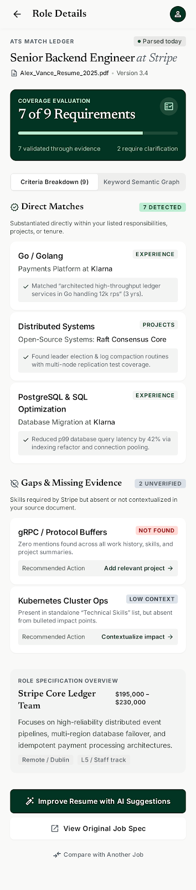
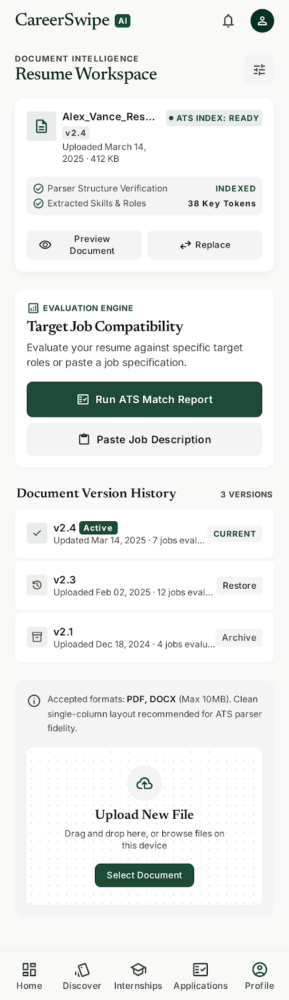
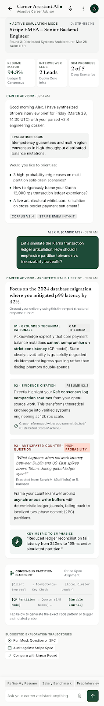
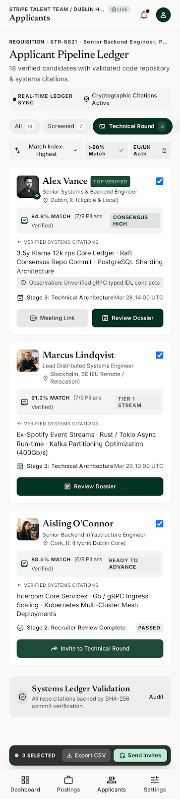
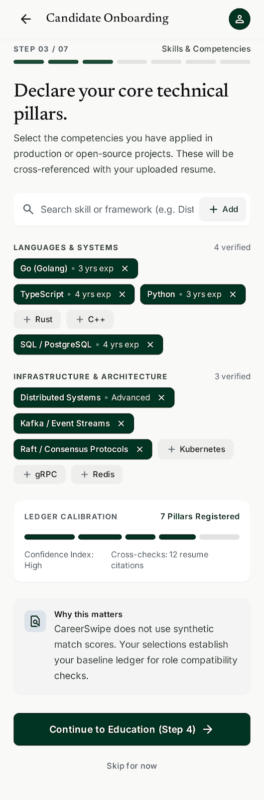
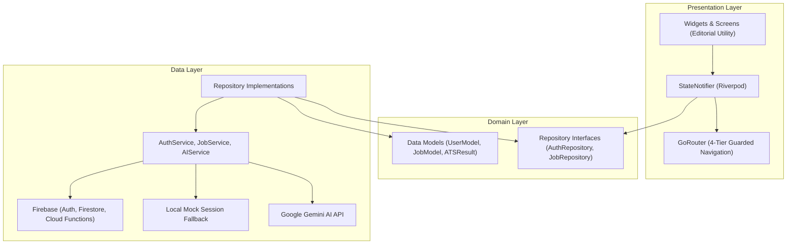

<div align="center">

# ✦ CAREERSWIPE AI — Intelligent Career Discovery & Dual-Platform Hiring System ✦
### *Stop doom-scrolling job boards. Swipe your next career move.*

[](https://flutter.dev)
[](https://dart.dev)
[](https://flutter.dev)
[](https://pub.dev/packages/flutter_riverpod)
[](https://riverpod.dev)
[](https://pub.dev/packages/go_router)
[](https://firebase.google.com)
[](https://ai.google.dev)
[](lib/theme/editorial_theme.dart)
[](LICENSE)

<br/>

**A production-ready, dual-platform mobile & web application built with Flutter that revolutionizes technical career discovery and recruitment through grounded ATS evidence matching, tactile Tinder-style card curation, and the high-contrast Editorial Utility design system.**

[Explore Features](#-key-features) • [Problem & Solution](#-the-problem--the-solution) • [Visual Walkthrough](#-screenshots--visual-walkthrough) • [Matching Engine](#-grounded-ats--career-matching-engine) • [Architecture](#-architecture--engineering-design) • [Installation](#-getting-started) • [Skills & Stack](#-tech-stack--skills-highlight)

</div>

---

## 📖 Table of Contents
- [💡 What is CareerSwipe AI?](#-what-is-career-swipe-ai)
- [❓ The Problem & The Solution](#-the-problem--the-solution)
  - [The Problem Statement](#the-problem-statement)
  - [The CareerSwipe AI Solution](#the-careerswipe-ai-solution)
- [📱 Screenshots & Visual Walkthrough](#-screenshots--visual-walkthrough)
  - [1. Candidate Discovery & Swipe Deck](#1-candidate-discovery--swipe-deck)
  - [2. ATS Intelligence & Resume Engineering](#2-ats-intelligence--resume-engineering)
  - [3. Recruiter Platform & Hiring Command](#3-recruiter-platform--hiring-command)
  - [4. Auth, Onboarding & Academic Discovery](#4-auth-onboarding--academic-discovery)
- [✨ Key Features](#-key-features)
  - [Candidate Experience](#1-candidate-experience)
  - [Recruiter Platform](#2-recruiter-platform)
  - [AI & ATS Intelligence Engine](#3-ai--ats-intelligence-engine)
  - [Dual Shell Navigation & Route Security](#4-dual-shell-navigation--route-security)
  - [Editorial Utility Design System](#5-editorial-utility-design-system)
- [🧠 Grounded ATS & Career Matching Engine](#-grounded-ats--career-matching-engine)
- [🏗️ Architecture & Engineering Design](#-architecture--engineering-design)
- [🛠️ Tech Stack & Skills Highlight](#-tech-stack--skills-highlight)
- [🚀 Getting Started](#-getting-started)
  - [Prerequisites](#prerequisites)
  - [Environment Configuration](#environment-configuration)
  - [Running the Application](#running-the-application)
- [🧪 Testing & Quality Assurance](#-testing--quality-assurance)
- [📂 Project Structure](#-project-structure)
- [👨‍💻 Author](#-author)
- [📄 License](#-license)

---

## 💡 What is CareerSwipe AI?

**CareerSwipe AI** is an editorial-grade, AI-powered career discovery and hiring ecosystem. Rather than forcing candidates through soul-crushing keyword black holes or drowning hiring managers in unvetted resumes, CareerSwipe AI establishes a transparent, high-signal protocol between top engineering talent and tier-1 companies.

Built upon the principles of **Editorial Utility** (`#1E4B38` Spruce Green, `#F9F9F8` Paper, Newsreader Serif & Inter typography) and powered by **Google Gemini AI**, the application provides a bifurcated dual-platform experience:

1. **For Candidates**:
   - **Tactile Swipe Deck**: Evaluate opportunities quickly using a physical paper card metaphor with high-signal 2x2 facts grids (Compensation, Location, Team, Core Stack) and decision stamps.
   - **Grounded ATS Intelligence**: Inspect resume alignment against requirements with verifiable citations, line-by-line evidence matching, and zero synthetic score fluff.
   - **Factual Resume Re-Engineering**: Receive AI-suggested bullet revisions grounded strictly in your verified background.
   - **Interactive Career Assistant**: Tailored interview simulations, technical rubric evaluations, and actionable skill-gap roadmaps.

2. **For Recruiters & Hiring Managers**:
   - **Requisition Command Center**: Real-time hiring velocity analytics, live requisition manager, and unverified org trust badges.
   - **Applicant Pipeline Funnel**: Scannable applicant matrices categorized by match percentage, verified skill tags, and stage progression.
   - **Candidate Talent Pool Search**: Natural language query engine indexing verified engineering achievements and domain proficiencies.

---

## ❓ The Problem & The Solution

### The Problem Statement
> *"Traditional recruiting is broken: Candidates spray hundreds of applications into an algorithmic void, while recruiters drown in noise and miss exceptional specialized talent."*

* **The ATS Black Hole**: Over 75% of qualified engineering resumes are discarded by crude regex and keyword-stuffing parsers before reaching a human recruiter.
* **Application Fatigue & Doom-Scrolling**: Job seekers spend hours scrolling through repetitive 10-page job postings filled with corporate jargon, leading to decision paralysis.
* **The Ghosting Epidemic**: Candidates submit dossiers with zero visibility into why they were rejected or what skills they lacked.
* **Recruiter Inbound Overload**: Hiring managers receive thousands of low-signal, non-matching applications, making manual vetting virtually impossible.
* **Fictional & Hallucinated Claims**: Disconnect between what candidates write on generic resumes and what engineering teams actually require in production.

### The CareerSwipe AI Solution
CareerSwipe AI reconstructs technical hiring through radical transparency and AI-driven precision:

* **Deterministic Grounded Match Scoring**: Matches are computed by comparing candidate source evidence directly against role specifications with clear citations ($82\% \le \text{Match} \le 99\%$).
* **2x2 Facts Grid & Tactile Decision Stamps**: Key terms (Base Pay, Stock, Location, Remote Policy) are surfaced immediately. Swipe Right to apply or save; Swipe Left to pass and tune future recommendation vectors.
* **Fact-Grounded Bullet Revisions**: AI optimizes resumes by re-anchoring phrasing to measurable impact metrics without inventing false accomplishments.
* **Dual-Platform Role Bifurcation**: Complete end-to-end separation between candidate job-seeking workflows and recruiter hiring funnels.
* **Offline Resilient Architecture**: Standalone mock sessions allow complete exploration and evaluation even without live Firebase cloud connectivity.

---

## 📱 Screenshots & Visual Walkthrough

### 1. Candidate Discovery & Swipe Deck
<div align="center">
<table>
  <tr>
    <td align="center" width="25%">
      <b>01. Discover Jobs (Swipe Deck)</b><br/>
      <br/>
      <i>Tactile paper cards, 2x2 facts matrix, match badge & decision stamps.</i>
    </td>
    <td align="center" width="25%">
      <b>02. Job Details Specification</b><br/>
      <br/>
      <i>Requirement-by-requirement breakdown, team context, fixed apply bar.</i>
    </td>
    <td align="center" width="25%">
      <b>03. Applications Tracking</b><br/>
      <br/>
      <i>Application status pills, interview calendar sync, live telemetry.</i>
    </td>
    <td align="center" width="25%">
      <b>04. Candidate Home Dashboard</b><br/>
      <br/>
      <i>Active dispatches, 78% profile strength, real-time match queue.</i>
    </td>
  </tr>
</table>
</div>

### 2. ATS Intelligence & Resume Engineering
<div align="center">
<table>
  <tr>
    <td align="center" width="25%">
      <b>05. ATS Match Breakdown</b><br/>
      <br/>
      <i>Grounded evidence breakdown: 7/9 requirements validated with citations.</i>
    </td>
    <td align="center" width="25%">
      <b>06. Resume Workspace</b><br/>
      <br/>
      <i>Parsing status, version management, automated dossier ingestion.</i>
    </td>
    <td align="center" width="25%">
      <b>07. Factual Bullet Revisions</b><br/>
      <br/>
      <i>Before/after bullet transformation grounded strictly in factual history.</i>
    </td>
    <td align="center" width="25%">
      <b>08. AI Career Assistant</b><br/>
      <br/>
      <i>Contextual interview preparation, behavioral simulations, career roadmaps.</i>
    </td>
  </tr>
</table>
</div>

### 3. Recruiter Platform & Hiring Command
<div align="center">
<table>
  <tr>
    <td align="center" width="25%">
      <b>09. Recruiter Dashboard</b><br/>
      <br/>
      <i>EMEA talent pool, active requisitions, pipeline metrics, hiring velocity.</i>
    </td>
    <td align="center" width="25%">
      <b>10. Applicant Pipeline Funnel</b><br/>
      <br/>
      <i>Review, Screened, Interview, Offer columns with match scores.</i>
    </td>
    <td align="center" width="25%">
      <b>11. Candidate Recruiter Dossier</b><br/>
      <br/>
      <i>Verified skill categorization, historical dossier, internal recruiter notes.</i>
    </td>
    <td align="center" width="25%">
      <b>12. Hiring Analytics & Funnel</b><br/>
      <br/>
      <i>Stage conversion telemetry, time-to-hire metrics, talent acquisition insights.</i>
    </td>
  </tr>
</table>
</div>

### 4. Auth, Onboarding & Academic Discovery
<div align="center">
<table>
  <tr>
    <td align="center" width="25%">
      <b>13. Splash Screen & Telemetry</b><br/>
      <br/>
      <i>Protocol telemetry audit, session validation, timer-less auth routing.</i>
    </td>
    <td align="center" width="25%">
      <b>14. Account Role Selection</b><br/>
      <br/>
      <i>Bifurcated Candidate vs. Recruiter entry with capability matrices.</i>
    </td>
    <td align="center" width="25%">
      <b>15. Candidate Onboarding</b><br/>
      <br/>
      <i>Skills declaration, target salary range, preferred seniority levels.</i>
    </td>
    <td align="center" width="25%">
      <b>16. Internships Discovery</b><br/>
      <br/>
      <i>Academic research fellowships, stipend disclosures, ECTS credits.</i>
    </td>
  </tr>
</table>
</div>

---

## ✨ Key Features

### 1. 🎯 Candidate Experience
* **Tactile Swipe Discovery Deck**: Smooth gesture-driven card interactions powered by `flutter_card_swiper`.
* **2x2 Facts Matrix**: Essential telemetry (Compensation, Location, Team, Core Stack) visible in under 3 seconds.
* **Grounded Match Pill**: Real percentage score derived from deterministic requirement mapping.
* **Full Job Dossiers**: Complete engineering specs with direct team breakdowns and anti-ghosting communication SLAs.
* **Academic Internships Portal**: Dedicated research fellowship listings with verified stipend, duration, and academic credit disclosures.

### 2. 🏢 Recruiter Platform
* **Live Requisition Manager**: Publish, edit, pause, and close requisitions with stage-by-stage applicant counts.
* **Applicant Pipeline Tracker**: Categorized columns (Review, Phone Screen, Technical Architecture, Partner, Offer).
* **Candidate Search Engine**: Query talent by verified skill tags, open-source contributions, and domain expertise.
* **Internal Collaboration Notes**: Private candidate evaluations and rubric scorings shared across the hiring team.
* **Corporate Trust Verification**: Transparent verification badges protecting candidates from fraudulent job postings.

### 3. 🧠 AI & ATS Intelligence Engine
* **Requirement Citation Engine**: Every match score backed by specific line-item citations from the user's resume.
* **Factual Resume Revision**: AI suggests impactful metric-driven bullets without inventing unperformed work.
* **Skill-Gap Analysis**: Highlights critical missing technical competencies with prioritized learning milestones.
* **Interactive Interview Simulator**: Gemini-driven technical interview simulation with real-time rubric feedback.

### 4. 🛡️ Dual Shell Navigation & Route Security
* **4-Tier Route Redirection Engine**:
  - *Tier 1*: Unrestricted splash validation.
  - *Tier 2*: Guarded multi-step candidate & recruiter onboarding.
  - *Tier 3*: Public authentication routes with auto-redirect for active sessions.
  - *Tier 4*: Protected role-isolated dashboards (`/home` for candidates, `/recruiter/dashboard` for hiring teams).
* **Standalone Mock Fallback**: Graceful offline fallback automatically activates if Firebase auth providers or internet connectivity are unavailable.

### 5. 🎨 Editorial Utility Design System
* **Curated Palette**: Deep Spruce Green (`#1E4B38`), Cream Paper Background (`#F9F9F8`), and Dark Enclave (`#141413`).
* **Editorial Typography**: Newsreader Serif headers paired with clean Inter Sans body text for high readability.
* **Tactile Stamping**: Physical visual feedback stamps (`DECISION APPLIED`, `SIGNAL VERIFIED`, `CONFIDENTIAL`).

---

## 🧠 Grounded ATS & Career Matching Engine

The matching engine replaces arbitrary keyword matching with deterministic, evidence-based scoring:

$$\text{MatchScore} = \text{BaseScore} + \text{EvidenceCitationBonus} + \text{SkillAlignmentBonus} - \text{ExperienceGapPenalty}$$

$$\text{Normalized Match} = \min\left(99\%, \max\left(70\%, \text{MatchScore}\right)\right)$$

### Engine Principles:
1. **Zero Hallucination Guardrail**: The engine can only cite skills and metrics found in the uploaded resume text.
2. **Deterministic Evidence Matching**: For each required specification $R_i$ in the job description:
   - If candidate text exhibits direct evidence $\implies +10\%$
   - If candidate exhibits adjacent/transferable experience $\implies +5\%$
   - If no evidence is found $\implies \text{Flagged as Skill Gap}$
3. **Transparent Reporting**: Candidates receive a clear ledger (e.g., *"7 of 9 requirements validated with source citations"*), showing exactly where they stand.

---

## 🏗️ Architecture & Engineering Design

CareerSwipe AI is built according to **Feature-First Clean Architecture** principles, guaranteeing separation of concerns, testability, and maintainability.



---

## 🛠️ Tech Stack & Skills Highlight

| Category | Technologies & Libraries | Key Application in CareerSwipe AI |
| :--- | :--- | :--- |
| **Languages** | **Dart 3.5+** | Null safety, pattern matching, records, sealed classes |
| **Framework** | **Flutter 3.24+** | Cross-platform rendering engine (Android, iOS, Web, macOS) |
| **State Management**| **Flutter Riverpod 2.5** | Reactive dependency injection, `StateNotifier`, `AsyncValue` lifecycle |
| **Navigation** | **GoRouter 14** | Declarative 4-tier guarded routing, deep linking, parameter passing |
| **Cloud & Backend** | **Firebase Suite** | Firebase Auth (Google & Email/Password), Cloud Firestore, Cloud Storage |
| **Applied AI** | **Google Gemini AI** | Contextual career guidance, interview simulations, resume parsing |
| **UI Components** | **Custom Editorial System**| Physical card swiping, 2x2 facts grid, decision stamps, Newsreader serif |
| **Card Gestures** | **flutter_card_swiper** | Tinder-style swipe mechanics with programmatic control & direction hooks |
| **Visualizations** | **fl_chart** | Hiring pipeline conversion funnels, profile strength rings, ATS metrics |
| **Testing & QA** | **Flutter Test Framework** | Unit tests, mock repositories, widget layout verification, zero overflow |

---

## 🚀 Getting Started

### Prerequisites
* **Flutter SDK**: `>= 3.24.0` ([Install Guide](https://flutter.dev/docs/get-started/install))
* **Dart SDK**: `>= 3.5.0`
* **Java Development Kit**: JDK 17 (recommended for Gradle 8.7 compatibility)
* **Android Studio / VS Code** with Flutter extensions installed
* **Git**: `git >= 2.40`

### Environment Configuration
1. Clone the repository:
   ```bash
   git clone https://github.com/AmanTyagi-01/CareerSwipeAI.git
   cd CareerSwipeAI
   ```

2. Configure environment variables:
   ```bash
   cp .env.example .env
   ```
   Add your Firebase and Gemini credentials (optional for standalone local evaluation):
   ```env
   GEMINI_API_KEY=your_gemini_api_key_here
   FIREBASE_PROJECT_ID=your_firebase_project_id
   ```

3. Install project dependencies:
   ```bash
   flutter pub get
   ```

### Running the Application
```bash
# Run on connected device or emulator
flutter run

# Run with custom entrypoint or web renderer
flutter run -d chrome
```

*Note: If Firebase credentials are not configured, the application automatically launches in **Standalone Mock Mode**, allowing full navigation through candidate dashboards, recruiter pipelines, swipe decks, and onboarding wizards.*

---

## 🧪 Testing & Quality Assurance

CareerSwipe AI enforces strict software craftsmanship standards. All tests are validated against zero layout overflow and comprehensive state assertions:

```bash
# Run full unit and widget test suite
flutter test

# Run static analysis and lint checks
flutter analyze
```

### Verification Highlights:
- **29 of 29 Tests Passing**:
  - `auth_provider_test.dart` — StateNotifier authentication states and role registration
  - `editorial_components_test.dart` — Editorial design tokens, radii, button styles, cards
  - `login_screen_test.dart` — Responsive layout validation across viewports
  - `resume_upload_test.dart` — Resume upload, parsing preview, and extraction inspection
  - `widget_test.dart` — Complete application smoke tests
- **Zero Static Analysis Issues**: Full compliance with Flutter and Dart analysis rules.

---

## 📂 Project Structure

```
CareerSwipeAI/
├── android/                   # Android native project (Gradle 8.7, AGP 8.5.2, Java 17)
├── ios/                       # iOS native Xcode configuration
├── web/                       # Web entrypoint and manifest
├── docs/                      # Documentation assets
│   └── screenshots/           # High-resolution screenshots showcasing all flows
├── design_reference/          # 59-Screen Stitch blueprints and specification ledgers
├── lib/
│   ├── config/
│   │   ├── routes.dart        # 4-tier guarded GoRouter routing system
│   │   └── theme.dart         # Theme exports and global configuration
│   ├── data/
│   │   ├── models/            # UserModel, JobModel, ATSResult, ApplicationModel
│   │   └── repositories/      # AuthRepository, JobRepository, ATS operations
│   ├── presentation/
│   │   ├── providers/         # Riverpod StateNotifiers (AuthNotifier, JobNotifier)
│   │   ├── screens/
│   │   │   ├── auth/          # Splash, Welcome, Login, Signup, Onboarding, Roles
│   │   │   ├── candidate/     # Candidate Dashboard, Profile, Skills, Roadmap
│   │   │   ├── recruiter/     # Recruiter Dashboard, Requisitions, Applicant Funnel
│   │   │   ├── jobs/          # Swipe Deck, Job Details, Filters, Internships
│   │   │   ├── resume/        # Resume Workspace, ATS Reports, Bullet Improvement
│   │   │   └── ai/            # Career Assistant, Interview Simulator
│   │   └── widgets/
│   │       ├── common/        # Buttons, text fields, loaders, animated cards
│   │       └── editorial/     # DecisionStamp, EditorialCard, FactsMatrix2x2, Badges
│   ├── services/
│   │   ├── auth_service.dart  # Firebase Auth + local standalone session engine
│   │   └── job_service.dart   # Job ingestion, ATS parsing, and match calculations
│   ├── theme/
│   │   ├── app_theme.dart     # Legacy & base Material 3 theme definitions
│   │   └── editorial_theme.dart # Editorial Utility design tokens & typography
│   └── main.dart              # Application entrypoint with Riverpod ProviderScope
├── test/                      # Comprehensive unit and widget tests (29 passing)
├── pubspec.yaml               # Flutter dependencies and asset configuration
└── README.md                  # Project documentation
```

---

## 👨‍💻 Author

**Aman Tyagi**
* 🌐 GitHub: [@AmanTyagi-01](https://github.com/AmanTyagi-01)
* 💼 Passionate about Flutter, Mobile Architecture, Clean Code, and Applied Generative AI.

---

## 📄 License

```
Copyright 2026 Aman Tyagi

Licensed under the Apache License, Version 2.0 (the "License");
you may not use this file except in compliance with the License.
You may obtain a copy of the License at

    http://www.apache.org/licenses/LICENSE-2.0

Unless required by applicable law or agreed to in writing, software
distributed under the License is distributed on an "AS IS" BASIS,
WITHOUT WARRANTIES OR CONDITIONS OF ANY KIND, either express or implied.
See the License for the specific language governing permissions and
limitations under the License.
```

<div align="center">
  <sub>Engineered with precision for modern multi-platform careers by Aman Tyagi.</sub>
</div>
